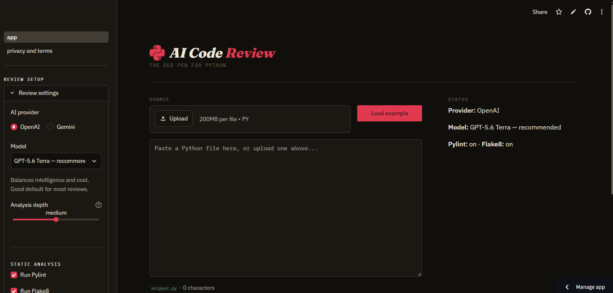

# AI Code Review Assistant

An AI-assisted Python code reviewer that combines **Pylint** and **Flake8** findings with a structured review from **OpenAI** or **Google Gemini**. Paste or upload a Python file to find bugs, security and performance concerns, and maintainability issues in one place.

[](https://www.python.org/)
[](https://streamlit.io/)

**Live app:** [ai-code-review-assistant-clean.streamlit.app](https://ai-code-review-assistant-clean.streamlit.app/)

## App preview



## Features

- **AI code review:** Choose OpenAI or Gemini and select the model and reasoning depth.
- **Static analysis:** Run Pylint and Flake8 independently or together.
- **Grounded findings:** Static-analysis results are passed to the AI as context, helping it focus on issues beyond style warnings.
- **Python syntax validation:** Invalid syntax is reported before analysis starts.
- **Report export:** View and download a Markdown report containing findings and the reviewed source.
- **Code input options:** Paste code, upload a `.py` file, or load the built-in example.
- **No execution of submitted code:** The app parses and analyzes source; it does not run the submitted program.
- **Server-side credentials:** API keys come from environment variables or Streamlit secrets, never from a browser input field.
- **Privacy & Terms page:** Review how submitted code, provider requests, credentials, and AI output are handled.
- **Fresh results:** Previous findings are cleared when source code or review settings change.

## Technology stack

| Area | Technologies |
| --- | --- |
| Language and UI | Python 3.10+, Streamlit |
| AI providers | OpenAI Responses API, Google Gemini Interactions API |
| AI SDKs | `openai`, `google-genai` |
| Static analysis | Pylint, Flake8 |
| Data validation | Pydantic |
| Configuration | `python-dotenv`, environment variables, Streamlit secrets |
| Testing | pytest |

Dependency version ranges are maintained in [`requirements.txt`](requirements.txt). The selected model IDs are configured in [`core/ai_reviewer.py`](core/ai_reviewer.py).

## Getting started

### 1. Install

```shell
git clone https://github.com/KisholoyDD21/ai-code-review-assistant-clean.git
cd ai-code-review-assistant-clean
python -m venv .venv
```

Activate the virtual environment:

```powershell
# Windows PowerShell
.\.venv\Scripts\Activate.ps1
```

```shell
# macOS / Linux
source .venv/bin/activate
```

Install the dependencies:

```shell
python -m pip install -r requirements.txt
```

### 2. Configure an AI provider (optional)

Pylint and Flake8 work without an AI key. To enable AI reviews, configure the key for the provider you intend to use. Keys are read on the server and are not entered or displayed in the web app.

For local development, copy `.env.example` to `.env` and add your key:

```dotenv
OPENAI_API_KEY=your-openai-key
GEMINI_API_KEY=your-gemini-key
```

You only need to set the key for the provider you use. `.env` is ignored by Git.

Alternatively, add the key to `.streamlit/secrets.toml`:

```toml
OPENAI_API_KEY = "your-openai-key"
GEMINI_API_KEY = "your-gemini-key"
```

For hosted deployments, configure secrets in the hosting platform (for example, Streamlit Community Cloud's app secrets). Do not commit credentials to the repository. Environment variables take precedence over Streamlit secrets when both are set.

### 3. Run

```shell
streamlit run app.py
```

Open the local URL printed by Streamlit, paste or upload Python code, choose the analysis options, and select **Run review**.

## How it works

1. The app checks the submitted source with Python's AST parser and reports syntax errors early.
2. Enabled static analyzers inspect the source in temporary files with subprocess timeouts.
3. If a provider key is configured, the source and static findings are sent to the selected AI provider for a schema-constrained review.
4. Findings are shown in the app and can be exported as a Markdown report.

## Project layout

```text
app.py                    Streamlit UI and review flow
core/
  ai_reviewer.py          OpenAI and Gemini provider integrations
  models.py               Pydantic review-result schema
  report.py               Markdown report generation
  static_analysis.py      Pylint and Flake8 wrappers and parsers
ui/
  components.py           Reusable UI components
  styles.py               Theme and CSS
tests/
  test_static_analysis.py Static-analysis tests
  test_app_ui.py          UI and result-state regression tests
pages/
  privacy_and_terms.py    In-app privacy and terms information
docs/images/              README screenshots
.streamlit/config.toml    Streamlit theme and server configuration
requirements.txt          Runtime and test dependencies
```

## Run tests

```shell
pytest tests/ -v
```

The static-analysis tests use the real Pylint and Flake8 tools. They also verify that analyzing a sample designed to write a file and exit does not execute that code. AI-provider calls are not covered by the test suite because they require live credentials and return nondeterministic results.

## Security and privacy

- The app does not expose an API-key field in the browser. Configure keys in the server environment, `.env`, or Streamlit secrets.
- API keys must not be committed. Keep `.env` and `.streamlit/secrets.toml` private.
- Submitted code is sent to the selected AI provider only when an API key is configured and an AI review is run. Review your provider's data-handling terms before sending sensitive source code.
- The static analyzers inspect source without executing the submitted program. As with any hosted web app, use appropriate access controls before deploying it publicly.

## Limitations

- Reviews one Python file at a time; there is no cross-file or repository-wide context.
- Static checks are limited to Pylint and Flake8; type checkers and dedicated security scanners are not included.
- Review history is not persisted.
- AI-generated findings are suggestions and should be verified before applying.
